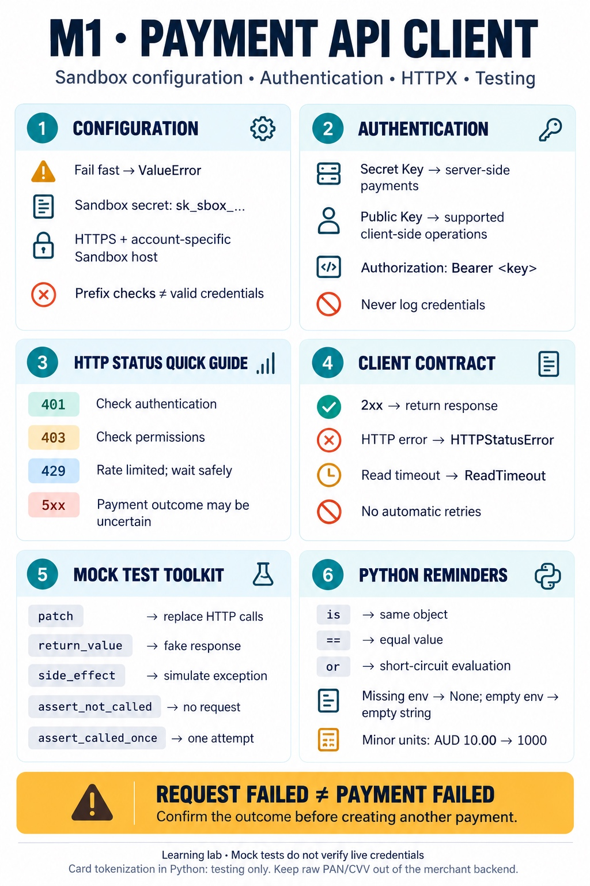
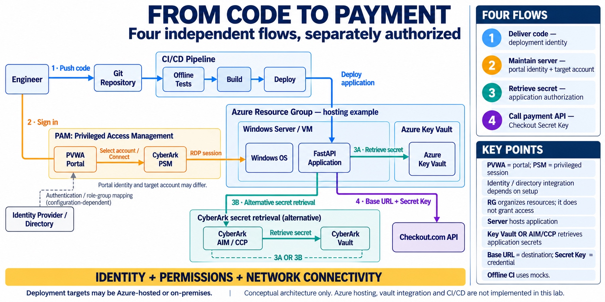
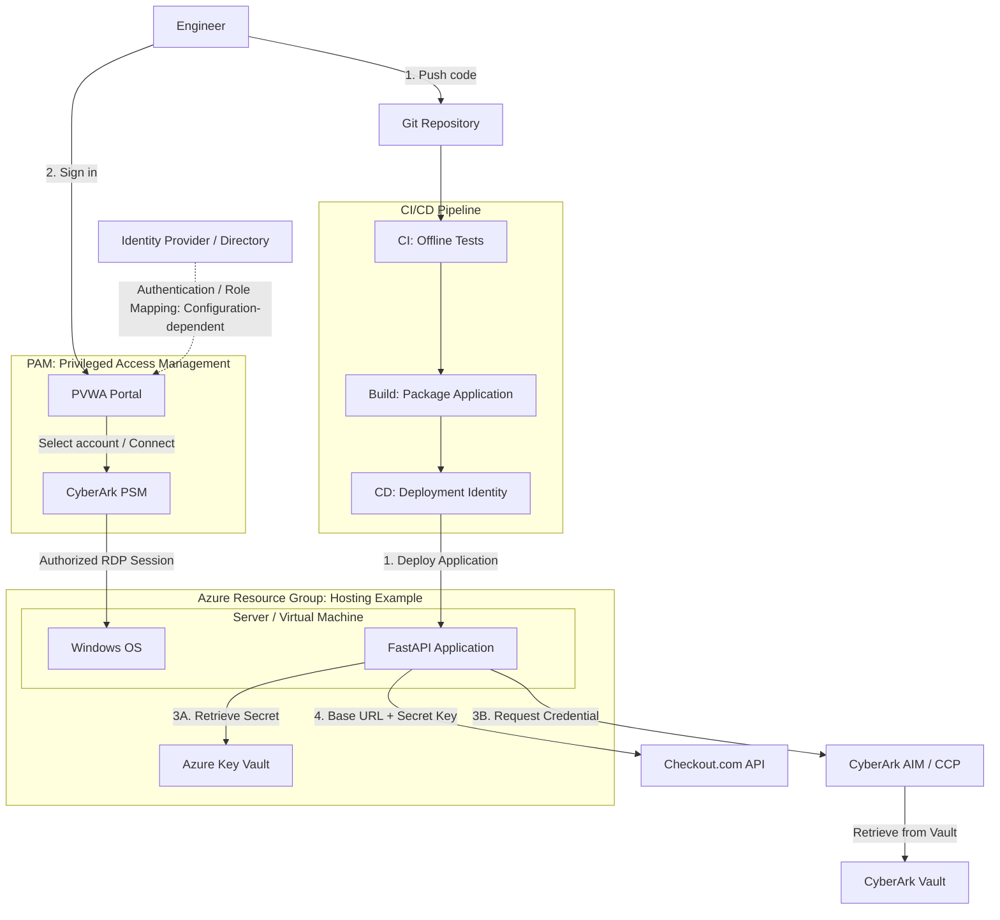

# M1 Key Learnings — Configuration and HTTPX Client



M1 establishes a Sandbox-only API client with local configuration checks,
authentication headers, explicit timeouts, and error propagation. It does not
verify live credentials or implement payment reconciliation.

## Configuration: fail early

- Read configuration from environment variables rather than hardcoding keys.
- Raise a clear `ValueError` when required configuration is missing.
- Name the invalid variable in errors without including its value.
- A key prefix is a format check, not proof that the key exists or has permission.
- Validate the destination as well as the key before sending credentials.

The client requires an `sk_sbox_` secret key and an HTTPS base URL matching
`{prefix}.api.sandbox.checkout.com`. URL parsing separates the scheme, hostname,
credentials, port, path, query, and fragment. A substring check could mistakenly
accept `test.api.sandbox.checkout.com.example.org`.

## Authentication versus authorization

| Concept | Question | HTTP error scenario |
| --- | --- | --- |
| Authentication | Who are you? | `401`: check the key, environment, and authentication header. |
| Authorization | Are you allowed to do this? | `403`: investigate the key or account permissions. |

Payment creation and lookup use a server-side Secret Key in the
`Authorization: Bearer ...` header. A Public Key is for supported client-side
operations and must not be confused with the Secret Key.

The Python `create_token(card)` method is a learning exercise. Direct card token
requests are for testing only. The intended merchant checkout uses a supported
client-side component; the merchant backend must not receive raw PAN/CVV.

## HTTP responses versus transport errors

Receiving an HTTP response does not mean the operation succeeded.
`response.raise_for_status()` raises `httpx.HTTPStatusError` for error statuses,
while a successful response can be returned to the caller. The exception retains
the response, allowing the caller to inspect its status code.

A `httpx.ReadTimeout` means the client did not receive the response in time.
It does not establish whether the provider processed the request.

| Result | Meaning for the caller |
| --- | --- |
| Successful HTTP response | Inspect the payment status; HTTP success alone does not authorize fulfillment. |
| `401` or `403` | Investigate authentication or permissions rather than retrying unchanged. |
| `429` | Handle rate limiting with a bounded, operation-safe retry policy later. |
| `5xx` or payment request timeout | The payment outcome may be uncertain; do not assume failure. |
| Failed payment lookup | The lookup failed; this does not prove the payment failed. |

### Merchant scenario: a payment response is lost

A customer submits an AUD 10.00 payment. The provider may process it before the
backend times out or receives a server error. Creating a fresh payment immediately
could charge the customer twice.

The client propagates the error without automatically retrying. Future application
logic must keep the outcome uncertain, withhold fulfillment, and reconcile using
payment lookup when an ID is available or a verified webhook. Missing webhooks
are not proof of failure. Safe payment retries require an idempotency strategy.

Capture is a separate payment lifecycle operation: requesting collection of
authorized funds. It does not mean receiving an HTTP response.

## Python concepts used

- `os.getenv()` returns `None` for an absent variable and `""` for an empty value.
  Both are falsy; a whitespace-only string is truthy.
- `or` short-circuits: when the left side is true, Python skips the right side.
  This prevents calling string methods on `None` or comparing a string amount
  with zero after its type has already been rejected.
- `is` checks object identity; `==` checks equality as defined by the objects.
  The response test uses `is` to verify that the original response is returned.
- `bool` is a subclass of `int`. The amount check uses `type(amount) is int`
  to reject `True` and `False` as payment amounts.
- Integer minor units avoid binary floating-point representation errors:
  AUD 10.00 is represented as `1000`. Amount validation was started alongside M1
  and belongs to M2.

## Testing without provider calls

| Tool | Purpose in these tests |
| --- | --- |
| `monkeypatch.setenv()` | Temporarily supply fake configuration. |
| `monkeypatch.delenv(..., raising=False)` | Simulate missing configuration, even if it was already absent. |
| `patch()` | Replace `httpx.get` or `httpx.post` so no real request is sent. |
| `return_value` | Supply a simulated provider response. |
| `side_effect` | Raise a simulated exception such as `ReadTimeout`. |
| `pytest.raises()` | Verify the exception type and, when relevant, its message. |
| `assert_not_called()` | Verify invalid input is rejected before the HTTP call. |
| `assert_called_once_with()` | Check call count and exact request arguments. |
| `assert_called_once()` | Verify the client does not automatically retry. |
| `pytest.mark.parametrize()` | Exercise multiple inputs or statuses with one test definition. |

Mock HTTP responses used with `raise_for_status()` need an attached
`httpx.Request`. Otherwise HTTPX raises `RuntimeError`, even for a successful
mock response. Each test must define its own inputs or receive them through a
fixture; local variables from another test are not shared.

From the project root, with the virtual environment activated:

```bash
cd backend
PYTHON_DOTENV_DISABLED=1 python -m pytest tests/test_checkout_client.py -q
```

This disables `.env` loading and selects the offline test file. The manual
connection/configuration scripts are not part of this test run. At M1 completion,
the suite had **60 passing cases**, including early M2 amount-validation work.
These tests verify local behavior, not live Sandbox authentication or processing.

## Architecture Context — People, Applications, Secrets, and Pipelines



This is a conceptual future architecture. Azure hosting, vault integration, and
CI/CD are not yet implemented in this lab.

The Resource Group illustrates an Azure-hosted example. Deployment targets may
also be on-premises. Identity, permissions, and network connectivity are separate
requirements. This diagram does not describe a specific company's infrastructure.

### Flows

1. **Code delivery:** An engineer pushes code. The pipeline runs offline tests,
   packages the application, and deploys it using a deployment identity.
2. **Server maintenance:** An engineer signs in to PVWA, selects an authorized
   target account, and requests a connection through PSM. PSM establishes the
   RDP session independently of pipeline deployment. Portal authentication and
   role/group mapping depend on the configured identity provider and directory.
3. **Secret retrieval:** At runtime, the application uses an authorized identity
   to retrieve credentials from Azure Key Vault or CyberArk AIM/CCP.
4. **Payment request:** The application calls the Checkout.com base URL with the
   Checkout Secret Key. Checkout.com authenticates and authorizes that request.

### Key Points

- A **Resource Group** organizes Azure resources; membership does not grant access.
- A **server/VM** provides a runtime environment; an **application** runs inside it.
- **PAM** is the discipline of managing privileged access. **CyberArk PSM** manages
  privileged sessions such as RDP.
- **PVWA** is the portal for account selection and connection requests. The
  portal identity and target server account may differ; they are not necessarily
  different accounts. No particular identity provider is assumed here.
- **Key Vault** stores secrets; **AIM/CCP** provides a way for applications to
  retrieve credentials managed in CyberArk. These are alternative retrieval paths
  in this example, not two required steps.
- Engineer access, pipeline deployment, application secret retrieval, and payment
  API access are separately authorized contexts; credentials should be scoped to
  their purpose rather than assuming one login grants every kind of access.
- The **base URL** selects the destination; the **Secret Key** authenticates the
  payment API call. Permission to read a vault does not itself grant payment access.
- Offline CI uses fake configuration and mocked requests, not real payment secrets.

### Architecture Diagram



Arrows to secret stores represent requests; the retrieved credential is returned
to the application. Flows 3A and 3B are alternatives. The RDP path illustrates a
Windows maintenance session; Linux administration typically uses SSH instead.

## References

- [Checkout.com authentication and base URLs](https://api-reference.checkout.com/)
- [Checkout.com Tokens reference](https://api-reference.checkout.com/tag/tokens)
- [Project requirements](../REQUIREMENTS.md)
