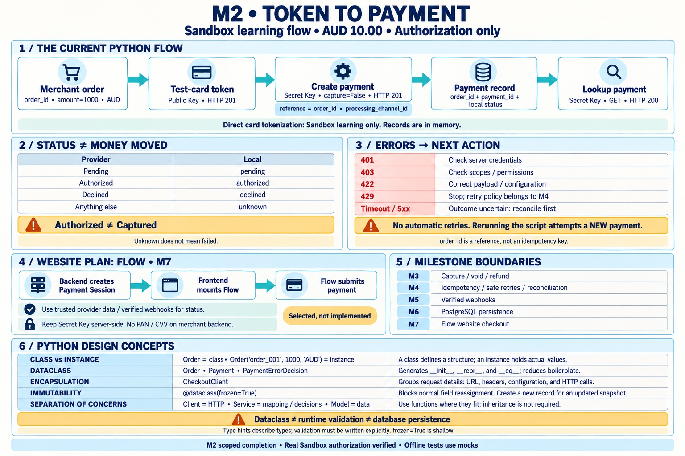

# M2 — Payment Creation and Lookup



Visual asset: [JPG cheat sheet](assets/m2-cheat-sheet.jpg).
The image-generation prompt is kept locally and excluded from Git.

## Completion scope

M2 completes the Python Sandbox learning flow, input validation, in-memory
order/payment association, initial status mapping, and operator error decisions.
It does not complete the website checkout or durable storage. This boundary was
agreed to separate provider integration from the later application milestones.

The user verified a live test-card token request (201), AUD 10.00 authorization
(201, Authorized), and payment lookup (200, Authorized). The latest changes were
verified offline only. No capture or automatic retry was added.

## Current flow

`Order reference → token-based create_payment → Payment record → payment lookup`

`payment_from_response()` associates the merchant order ID with the provider ID.
Required response fields must contain nonblank strings; malformed responses stop
conversion. They do not establish payment failure. Records live in memory and
are lost when the process exits. Each manual script run creates a new reference
and attempts a new payment; it is not a retry or a reconciliation command.

| Provider status | Local status | Meaning for this milestone |
| --- | --- | --- |
| Pending | pending | Awaiting an authorization/authentication result |
| Authorized | authorized | Authorization received; capture is separate |
| Declined | declined | Provider explicitly reported a decline |
| Anything else | unknown | Preserve uncertainty; do not infer success or failure |

This is a snapshot mapping. It does not implement state transitions, fulfillment,
capture/refund handling, or out-of-order webhook processing. See the official
[payment status explanation](https://support.checkout.com/hc/en-us/articles/37223151583506-Understanding-your-payment-statuses).

## Application error decisions

`classify_payment_error()` supplies fixed operator guidance without exposing
exception text, response bodies, credentials, or request URLs. The manual script
uses these decisions after HTTP or transport errors.

| Error | Category | Action |
| --- | --- | --- |
| 401 | authentication_error | Check server-side credentials |
| 403 | permission_error | Check API scopes and account permissions |
| 422 | invalid_request | Correct payload or configuration |
| 429 | rate_limited | Stop requests; future retry policy belongs to M4 |
| Transport errors, 5xx, other HTTP errors | connection_error / uncertain_outcome | Reconcile before another payment attempt |

401/403/422 describe a rejected request, not a declined card or the outcome of
earlier attempts. Rate limits and unclassified errors are treated conservatively
as uncertain. No error handler retries. Future FastAPI routes must not pass a
provider 401/403 straight through as though the customer failed authentication.
HTTP response mapping for those routes is deferred until the routes exist.

## Website integration decision: Flow Payment Sessions

Choose Checkout.com Flow for the planned website. As documented in the official
[Flow guide](https://www.checkout.com/docs/get-started), the backend creates a
Payment Session using the secret key, the frontend mounts Flow with session
data and a public key, and Flow submits the payment and handles additional
customer actions. Payment status is reconciled through trusted provider data
and webhooks, not a browser success message alone.

This is a session-based integration. The website must not invoke the Python
`create_token(card)` exercise, receive PAN/CVV on the merchant backend, or also
call the current token-based `create_payment()` after Flow pays; doing both
could create another payment. Flow setup, account scopes, authorization-only
configuration, and endpoint details must be verified when implementing M7.
No Payment Session endpoint or frontend component has been implemented in M2.

## Python design concepts

| Concept | Project example | Why it helps |
| --- | --- | --- |
| Class vs instance | `Order` vs `Order("order_001", 1000, "AUD")` | The class defines the structure; each instance holds its own values. |
| Dataclass | `Order`, `Payment`, `PaymentErrorDecision` | Generates methods such as `__init__`, `__repr__`, and `__eq__`, reducing boilerplate. |
| Encapsulation | `CheckoutClient` | Groups configuration, URLs, authentication headers, and HTTP calls behind client methods. |
| Immutability | `@dataclass(frozen=True)` | Blocks ordinary field reassignment; create a new record for an updated payment snapshot. |
| Separation of concerns | Client, service functions, models | HTTP details, application decisions, and data structures have distinct responsibilities. |

Dataclasses are a Python tool for expressing data, not a separate OOP principle.
Type hints do not enforce runtime validation: `payment_from_response()` explicitly
checks the required response fields. Neither a dataclass nor `frozen=True` saves
anything to a database. Freezing is shallow: mutable objects inside fields would
still be mutable; the current models contain strings and integers.

Service logic can remain plain functions. No inheritance hierarchy is needed
for the current design. An immutable `Payment` is a snapshot, not a live object
that updates itself when the provider's status changes.

## Remaining milestones

- M3: Capture, void, refund operations and their state mappings.
- M4: Provider idempotency, retry policy, and reconciliation execution.
- M5: Verified, deduplicated webhooks and safe state updates.
- M6: PostgreSQL persistence for orders, payments, and operations.
- M7: Flow Payment Session backend integration and customer UI, including
  trusted order totals and customer authorization.

FR-002 remains partially fulfilled at the overall project level until durable
storage and the chosen website flow are implemented. M2 completion applies to
the scope above, not all of FR-002 or production readiness.

## Offline verification

From `backend/`:

```bash
PYTHON_DOTENV_DISABLED=1 ../.venv/bin/python -m pytest tests/clients tests/models tests/services tests/scripts -q
```

Result: **136 passed**. Script tests block real HTTP and verify request counts,
lookup identity, error guidance, and no automatic retries. Legacy manual scripts
still under `tests/` are excluded by selecting these directories explicitly.
