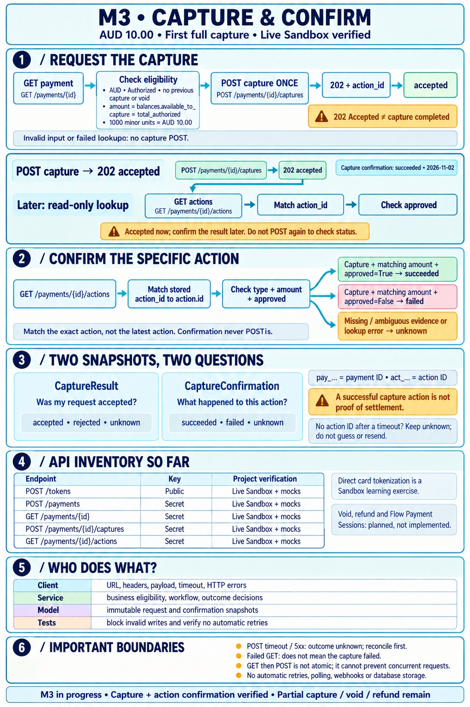
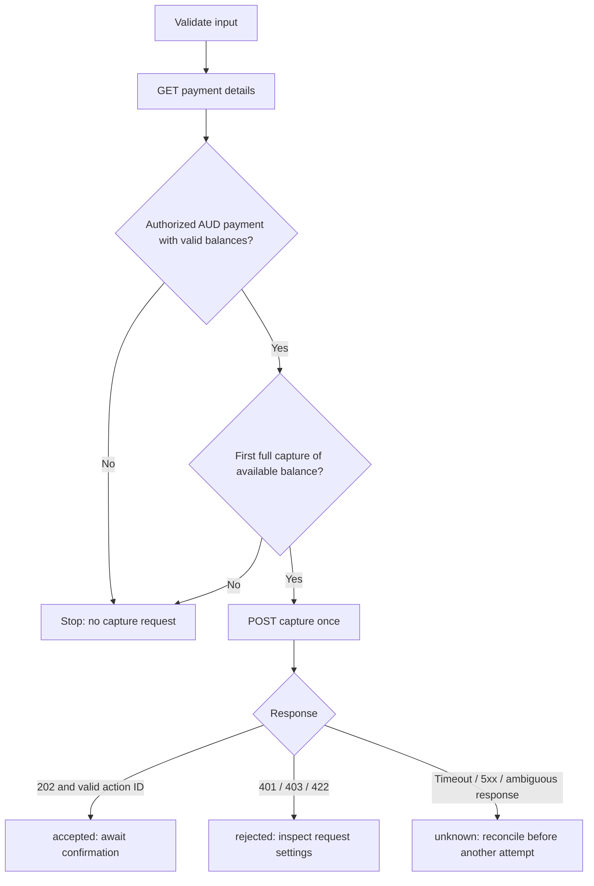

# M3 — Capture an Authorized Payment



The cheat sheet was generated with imagegen. Its generation prompt is kept
locally and excluded from Git.
The image highlights the two-stage asynchronous flow: POST capture → 202 accepted,
then a later read-only GET actions → match action ID → check approval.
Its verification labels include the user-run live Sandbox capture and action
confirmation on 2026-11-02. Capture success does not prove settlement.

Related reference: [API inventory and verification status](api-inventory.md).

## Business scenario

A merchant requests the first full capture of an AUD authorization. For an
authorization of AUD 10.00, the requested amount is `1000` minor units.
The reusable entry point is `capture_authorized_payment()` in
`backend/app/services/capture_service.py`. It accepts an injected client,
payment ID, amount, and capture reference; it does not create a payment or token.



## Walkthrough

Responsibilities: the **service** decides whether capture is eligible and
interprets the request outcome; the **client** handles GET/POST protocol details
and propagates errors; **CaptureResult** describes an in-memory outcome. This
keeps merchant rules testable while the provider client remains reusable.
See [layer responsibilities and rationale](m2-completion.md#layer-responsibilities-what-belongs-where-and-why)
for examples, validation boundaries, and trade-offs.

1. Validate the ID, positive integer amount, and nonblank reference before any
   request. Reject booleans and amounts above the provider's capture limit.
2. Call `client.get_payment(payment_id)`. Lookup HTTP/transport errors propagate;
   no capture is submitted. Invalid JSON, missing fields, ID mismatch, unsupported
   currency, or an ineligible status also stop the flow.
3. Read `balances.available_to_capture`, not the top-level original `amount`.
   Require integer balances, positive availability, `Authorized` status and AUD.
   For this deliberately narrow policy, `total_captured` and `total_voided` must
   both be zero, and the request must equal both availability and `total_authorized`.
   Partial captures and partially voided authorizations are outside this batch.
4. Call `client.capture_payment()` once. The client sends the Secret Key header,
   amount/reference payload, and explicit timeout.
5. Return an immutable `CaptureResult`. A valid `202` acknowledgement gives
   `status="accepted"` and a provider `action_id`; it never sets payment status to
   `captured`. A capture HTTP 401/403/422 gives `rejected` for this request, not a
   payment/card decline. Transport errors, rate limits, other HTTP failures,
   unexpected success codes, and malformed acknowledgements give `unknown`.
6. No branch retries, polls, or writes a database. The result is an in-memory
   snapshot retaining payment ID, amount, and reference for the caller.

The official [Payments API reference](https://api-reference.checkout.com/tag/payments)
defines `GET /payments/{id}`, the payment balance fields, and
`POST /payments/{id}/captures`. Card capture processing is asynchronous.

## Comments that explain behavior

`# POST /payments/{id}/captures` identifies the endpoint but does not explain
its business semantics. The client now has a docstring explaining that `202`
accepts an asynchronous request, eligibility belongs to the service, and errors
propagate without automatic retries. Comments in the service explain why lookup
balances and uncertain outcomes matter.

## Confirm a specific capture

After submitting a capture, call `confirm_capture(client, capture_result)` in a
separate read step. It calls `GET /payments/{id}/actions` once and matches the
stored `action_id` against each action's `id`. It checks `type == "Capture"` and
the exact integer amount before reading the boolean `approved` field.

| Evidence | Confirmation result |
| --- | --- |
| Exactly one matching capture, matching amount, `approved=True` | `succeeded` for this capture action |
| Exactly one matching capture, matching amount, `approved=False` | `failed` for this capture action |
| Missing action ID, action not listed yet, duplicate IDs, mismatched data, or absent approval | `unknown` |
| HTTP/transport error, malformed JSON or unexpected response shape | `unknown` |

The immutable `CaptureConfirmation` is separate from `CaptureResult`: request
acceptance and the subsequently observed outcome describe different moments.
Neither changes the original record or proves settlement. This is an internal
read service, not a polling worker or a webhook handler.

```python
# Internal service usage; example only, not an executable live API command.
capture = capture_authorized_payment(client, payment_id, 1000, "capture_order_001")
if capture.action_id is not None:
    confirmation = confirm_capture(client, capture)
```

Do not repeat the capture function to check a result: only call the read function.
If a POST timeout gave no action ID, this helper returns `unknown` without guessing
another action. Dashboard investigation or later M4 reconciliation must establish
the correct operation. A confirmed failed action also does not authorize an
automatic retry; a new operation requires explicit business handling.

## Limits and next steps

Manual entry points are `scripts/3_capture_sandbox_payment.py` (lookup and one
capture POST) and `scripts/4_confirm_sandbox_capture.py` (actions GET only), run
from `backend/`. Both accept expected amount and reference as CLI options; the
confirmation command also requires the saved action ID. See the README for
commands and exit codes. After acceptance, run only confirmation to check results.

The lookup and capture are separate calls. Another caller can change the payment
between them; a fresh GET is not a lock or a duplicate-operation guarantee.
Pending capture actions can also exist while a lookup still reports Authorized.
Do not use this service as proof that repeating a capture is safe.

- M4: Idempotency, operation tracking and reconciliation, including uncertain outcomes.
- M5: Verified capture events and state updates.
- M6: Durable operation/result storage and local concurrency controls.
- Application/API integration: authenticate and authorize merchant operators and
  verify their access to the payment before invoking this internal service.
- Remaining M3 work: partial capture, void and refund flows, with their tests
  and relevant Sandbox verification.

On 2026-11-02, the user received live Sandbox capture request acceptance and an
action ID, then ran the read-only confirmation script. It reported
`Confirmation: succeeded` and `Reason: None` for the specific AUD 10.00 action.
This validates the tested capture/confirmation path, not settlement, concurrency
safety, or other payment methods. Automated
tests mock HTTP and verify GET-before-POST, amount/state guards, zero POSTs for
blocked cases, a single POST for attempted captures, and uncertain outcomes.
Confirmation tests additionally verify exact action matching, missing evidence,
read failures, and no POST during confirmation. The full offline suite currently
has **310 passing tests**.
