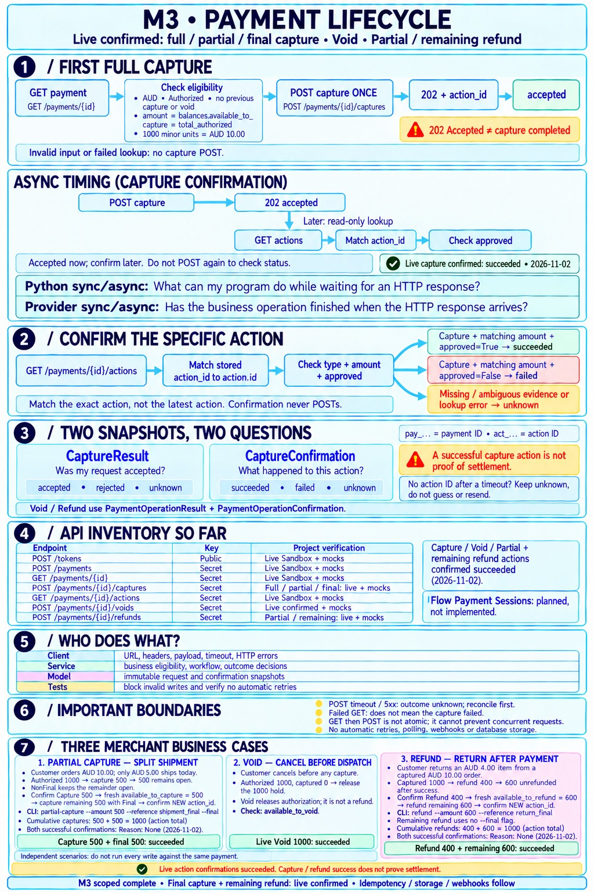
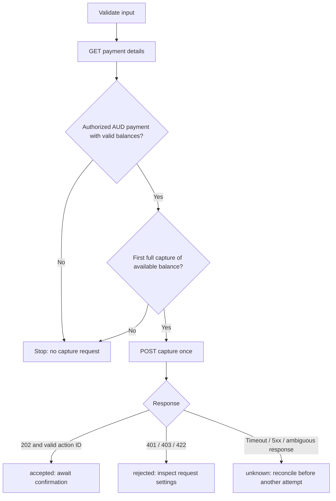
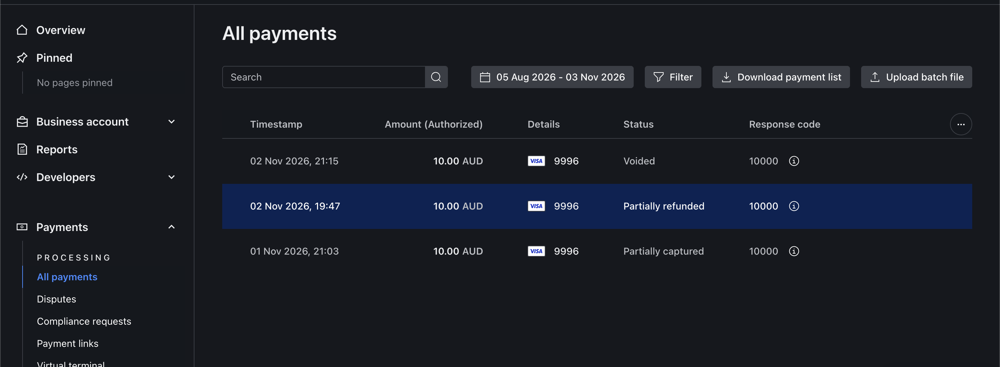

# M3 — Payment Lifecycle: Capture, Void, and Refund



This guide combines the full capture/confirmation walkthrough with partial
capture, void, refund, CLI examples, and verification evidence.
The cheat sheet was generated with imagegen; its prompt is kept locally and
excluded from Git. The Dashboard screenshot below is the user's original image.

**M3 scoped completion (2026-11-02):** internal AUD Sandbox services, CLI commands,
automated tests and representative live operation confirmations are complete.
Full capture, partial capture, void and partial refund actions were confirmed
live. Final-remaining capture `500` and remaining refund `600` were also confirmed
`succeeded`, with `Reason: None` for both actions.
This does not complete an authenticated merchant API, idempotency, storage,
webhooks or settlement verification.

Related references: [API inventory](api-inventory.md) and
[layer responsibilities](m2-completion.md#layer-responsibilities-what-belongs-where-and-why).

## Asynchronous timing: accepted now, confirmed later

```text
POST operation → 202 accepted
                       ↓ later: read-only lookup
GET actions → match action_id → check type, amount, approved
```

For card operations, request acceptance and the provider's completed action are
different moments. This timing is independent of Python `async def`/`await`:
our synchronous HTTP client can receive an asynchronous operation acknowledgement.
"Later" is not a fixed delay or an automatic polling loop.

| Snapshot | Question answered | Possible statuses |
| --- | --- | --- |
| `CaptureResult` / `PaymentOperationResult` | Was this request accepted? | accepted, rejected, unknown |
| `CaptureConfirmation` / `PaymentOperationConfirmation` | What happened to this exact action? | succeeded, failed, unknown |

`pay_...` identifies a payment; `act_...` identifies an individual action. A
payment can have several actions. Capture success does not prove settlement.

## Three additional merchant business cases

| Concept | Business situation | Example in minor units | Balance used |
| --- | --- | --- | --- |
| Partial capture | Ship part of an order and collect only that part now | Authorized `1000`; capture `500`, leave `500` open | `available_to_capture` |
| Void | Cancel an authorization before capturing money | Authorized `1000`, captured `0`; release `1000` | `available_to_void` |
| Refund | Return previously captured money | Captured `1000`; refund `400`, with `600` unrefunded after success | `available_to_refund` |

Void releases a hold; refund returns captured funds. A request being accepted
does not establish the final result or settlement. These are alternative merchant
scenarios, not instructions to run every command against the same payment.

## Implementation and responsibilities

- **Client:** `capture_payment()` can forward an explicit `capture_type`;
  `void_payment()` and `refund_payment()` send their respective requests. A small
  private helper shares headers, payload construction, timeout, and format checks.
- **Service:** `payment_operation_service.py` applies the AUD card-payment
  policies below, looks up balances, submits at most one write, and interprets
  acknowledgement/error evidence.
- **Models:** `PaymentOperationResult` records request acceptance/rejection/
  uncertainty; `PaymentOperationConfirmation` records a later action result.
  Both are immutable in-memory snapshots, not database rows.
- **Script:** `5_payment_operations.py` exposes explicit commands. It does not
  duplicate the rules or automatically move to the next financial operation.

The existing first-full-capture API remains available. Its `confirm_capture()`
adapter now reuses the same exact-action confirmation logic used by Void/Refund.
There are enough operations sharing these mechanics to justify a small helper;
there is no inheritance hierarchy or general workflow framework.

## First full capture: collect an authorized order

A merchant requests the first full capture of an AUD authorization. For an
authorization of AUD 10.00, the requested amount is `1000` minor units.
The reusable entry point is `capture_authorized_payment()` in
`backend/app/services/capture_service.py`. It accepts an injected client,
payment ID, amount, and capture reference; it does not create a payment or token.



### Service walkthrough

Responsibilities: the **service** decides whether capture is eligible and
interprets the request outcome; the **client** handles GET/POST protocol details
and propagates errors; **CaptureResult** describes an in-memory outcome. This
keeps merchant rules testable while the provider client remains reusable.
See [layer responsibilities and rationale](m2-completion.md#layer-responsibilities-what-belongs-where-and-why)
for examples, validation boundaries, and trade-offs.

1. Validate the ID, positive integer amount, and nonblank reference before any
   request. Reject booleans and amounts above the provider's capture limit.
2. Call `client.get_payment(payment_id)`. Lookup HTTP/transport errors propagate;
   no capture is submitted. Invalid JSON, missing fields, ID mismatch, unsupported
   currency, or an ineligible status also stop the flow.
3. Read `balances.available_to_capture`, not the top-level original `amount`.
   Require integer balances, positive availability, `Authorized` status and AUD.
   For this deliberately narrow policy, `total_captured` and `total_voided` must
   both be zero, and the request must equal both availability and `total_authorized`.
   Use the separate partial-capture service below for split shipments.
4. Call `client.capture_payment()` once. The client sends the Secret Key header,
   amount/reference payload, and explicit timeout.
5. Return an immutable `CaptureResult`. A valid `202` acknowledgement gives
   `status="accepted"` and a provider `action_id`; it never sets payment status to
   `captured`. A capture HTTP 401/403/422 gives `rejected` for this request, not a
   payment/card decline. Transport errors, rate limits, other HTTP failures,
   unexpected success codes, and malformed acknowledgements give `unknown`.
6. No branch retries, polls, or writes a database. The result is an in-memory
   snapshot retaining payment ID, amount, and reference for the caller.

The official [Payments API reference](https://api-reference.checkout.com/tag/payments)
defines `GET /payments/{id}`, the payment balance fields, and
`POST /payments/{id}/captures`. Card capture processing is asynchronous.

### Comments that explain behavior

`# POST /payments/{id}/captures` identifies the endpoint but does not explain
its business semantics. The client now has a docstring explaining that `202`
accepts an asynchronous request, eligibility belongs to the service, and errors
propagate without automatic retries. Comments in the service explain why lookup
balances and uncertain outcomes matter.

### Full capture and confirmation commands

Run from `backend/` after replacing the sample IDs. Submit the write only once:

```bash
python scripts/3_capture_sandbox_payment.py pay_REPLACE_WITH_PAYMENT_ID \
  --amount 1000 --reference capture_order_001
```

Keep the returned action ID, then check that specific capture in a separate read:

```bash
python scripts/4_confirm_sandbox_capture.py pay_REPLACE_WITH_PAYMENT_ID act_REPLACE_WITH_ACTION_ID \
  --amount 1000 --reference capture_order_001
```

The first command calls `capture_authorized_payment()`; the second calls
`confirm_capture()`, which adapts the shared exact-action confirmation logic.
Never rerun the write command just to check its outcome.

## Scenario 1: Partial capture and final remaining capture

`capture_payment_amount()` accepts Authorized or Partially Captured AUD card
payments. It validates integer balances and requires:

```text
total_authorized = total_captured + total_voided + available_to_capture
```

This is a conservative local eligibility policy. Missing, inconsistent, or
unreconciled balances stop the operation instead of guessing an amount.

- A partial request must be positive and smaller than availability. The service
  explicitly sends `capture_type="NonFinal"` to keep the remaining authorization open.
- A final request must equal all remaining availability. It sends `Final`.
  This merchant policy deliberately blocks a smaller Final request, which could
  otherwise release the uncollected remainder.
- Multiple captures still depend on the account, payment method, and provider
  eligibility. Local validation does not guarantee the provider accepts them.

From `backend/`, replace the sample ID and reference before opting into a live call:

```bash
python scripts/5_payment_operations.py partial-capture pay_REPLACE_WITH_PAYMENT_ID \
  --amount 500 --reference shipment_001
```

Confirm the first action using its returned ID (each command stays on one line):

```bash
python scripts/5_payment_operations.py confirm pay_REPLACE_WITH_PAYMENT_ID --action-id act_REPLACE_WITH_FIRST_CAPTURE_ACTION_ID --action-type Capture --amount 500 --reference shipment_001
```

After confirming the first action and checking current balances, a separate final
capture of a remaining `500` would use:

```bash
python scripts/5_payment_operations.py partial-capture pay_REPLACE_WITH_PAYMENT_ID --amount 500 --reference shipment_final --final
```

Keep the **new** action ID and confirm this final capture separately:

```bash
python scripts/5_payment_operations.py confirm pay_REPLACE_WITH_PAYMENT_ID --action-id act_REPLACE_WITH_FINAL_CAPTURE_ACTION_ID --action-type Capture --amount 500 --reference shipment_final
```

Do not run the second request merely because the first returned `accepted`.
Confirm the first operation and investigate uncertainty before any further write.
The final write performs a fresh lookup and requires `available_to_capture = 500`
for this example. Successful `500 + 500` actions imply `1000` captured; a fresh
payment snapshot should independently verify the resulting balances.

## Scenario 2: Void an uncaptured authorization

`void_authorized_payment()` requires Authorized status, no captured funds, and a
positive available-to-void balance consistent with authorization minus prior voids.
This flow only releases the full remaining authorization; partial void and void
after partial capture are deliberately outside its policy.

```bash
python scripts/5_payment_operations.py void pay_REPLACE_WITH_PAYMENT_ID \
  --amount 1000 --reference canceled_order_001
```

This needs an uncaptured authorization. The earlier live successfully captured
payment should not be used for this void example.

## Scenario 3: Full or partial refund

`refund_captured_payment()` accepts Captured, Partially Captured, or Partially
Refunded card snapshots, provided the amount is within positive provider refund
availability. Refund availability must not exceed captured minus already refunded
funds. Previous refunds reduce what can be returned; original order amount is not
the current refundable balance.

```bash
python scripts/5_payment_operations.py refund pay_REPLACE_WITH_PAYMENT_ID \
  --amount 400 --reference return_001
```

Full refund means requesting all current refundable availability. Both full and
partial refund are supported, but the provider still decides eligibility.
Amex operation references above 30 characters are rejected before the write;
the generic request reference limit remains 80 for other supported card schemes.

### Remaining refund after a partial return

If the customer later returns the remaining goods, first confirm the original
`400` refund using its action ID:

```bash
python scripts/5_payment_operations.py confirm pay_REPLACE_WITH_PAYMENT_ID --action-id act_REPLACE_WITH_FIRST_REFUND_ACTION_ID --action-type Refund --amount 400 --reference return_001
```

After `succeeded`, and with fresh `available_to_refund = 600`, submit the separate
remaining refund once. The service looks up current availability before the POST:

```bash
python scripts/5_payment_operations.py refund pay_REPLACE_WITH_PAYMENT_ID --amount 600 --reference return_final
```

Keep its **new** action ID and confirm that exact `600` action:

```bash
python scripts/5_payment_operations.py confirm pay_REPLACE_WITH_PAYMENT_ID --action-id act_REPLACE_WITH_REMAINING_REFUND_ACTION_ID --action-type Refund --amount 600 --reference return_final
```

Refund has no `--final` flag: requesting the full currently refundable balance
makes this a remaining refund. Successful `400 + 600` actions imply `1000`
refunded overall, rather than a second `1000` refund. Independently verify fresh
payment balances. Unknown outcomes require reconciliation before another write.
The final Capture and remaining Refund examples below were both confirmed
`succeeded`, `Reason: None` on 2026-11-02; do not resubmit those completed actions.

## Confirm each action without repeating a write

```bash
python scripts/5_payment_operations.py confirm pay_REPLACE_WITH_PAYMENT_ID \
  --action-id act_REPLACE_WITH_ACTION_ID --action-type Refund \
  --amount 400 --reference return_001
```

Use `Capture`, `Void`, or `Refund` for the exact expected action type. The service
reads actions once, then requires a unique matching ID, exact type, integer amount,
and boolean approval. Only explicit evidence produces `succeeded` or `failed`.
Missing IDs, mismatches, duplicate IDs, missing approval and lookup errors remain
`unknown`. No action ID means no guessing based on the latest action or reference.

| Evidence for the exact expected ID, type and amount | Result |
| --- | --- |
| One matching action with `approved=True` | succeeded |
| One matching action with `approved=False` | failed |
| Missing, ambiguous or malformed evidence; failed lookup | unknown |

Write commands exit `0` for accepted, `1` for blocked/rejected/errors and `2` for
unknown. Confirmation exits `0` for succeeded, `1` for failed/invalid input and
`2` for unknown. A failed action or lookup never triggers an automatic write retry.
HTTP `200` responses indicating an operation was already performed are handled
conservatively as unknown for this particular request, requiring reconciliation.

## State snapshots

The payment response mapper additionally recognizes `Partially Captured`,
`Captured`, `Voided`, `Partially Refunded`, and `Refunded`. Request acceptance
never sets those states. Mappings are snapshots, not transition enforcement;
webhook ordering and transactional updates remain future work.

## Verification and limitations

### User-provided Sandbox Dashboard evidence

The supplied Dashboard screenshot shows three separate AUD 10.00 authorizations
with the following displayed payment statuses:

| Dashboard status | Business case illustrated |
| --- | --- |
| Voided | Release an uncaptured authorization after cancellation |
| Partially refunded | Return part of previously captured funds |
| Partially captured | Collect part of an authorization for a split shipment |

The screenshot is supporting evidence that these states were observed in Sandbox.
Its **Amount (Authorized)** column is the authorized amount, not the amount
captured or refunded. It does not display the payment/action IDs or the exact
operation amounts, so it does not replace matching a specific action through
the API. The separate action-confirmation evidence remains tracked below.



On 2026-11-02, the user confirmed a specific AUD 10.00 full-capture action:
`Confirmation: succeeded`, `Reason: None`. This is action-level evidence, not
settlement or concurrency verification.
On 2026-11-02, the user also supplied these new live request results:

| Business case | Observed evidence | Action verification |
| --- | --- | --- |
| Split shipment / partial capture | Capture `500` accepted; Dashboard shows Partially captured | Exact Capture action confirmed succeeded, Reason None |
| Cancel before capture / void | New AUD 10.00 authorization; void `1000` accepted | Exact Void action confirmed succeeded, Reason None |
| Return after capture / refund | Previously captured AUD 10.00 payment; refund `400` accepted | Exact Refund action confirmed succeeded, Reason None |

### Known action lookup inputs

The user supplied the following identifiers and subsequent read-only confirmation
outputs. All three actions reported `succeeded` with `Reason: None` on 2026-11-02.

| Action type | Payment ID | Action ID | Amount | Reference |
| --- | --- | --- | --- | --- |
| Capture | `pay_elcyababuq5yhhkhqnxsn6tiry` | `act_ugtffbdscuievodaqmg7chrzbq` | 500 | shipment_001 |
| Void | `pay_ylccplibor5yfarvmhg322xdni` | `act_n7fzlqxsfifexfqpnqovig7g5u` | 1000 | canceled_order_001 |
| Refund | `pay_nna4tjqbpqbidl22nvvomxj6zm` | `act_2gst7qngpw7ufpbdd73qx5vgbq` | 400 | return_001 |

### Additional operations confirmed succeeded

The user subsequently submitted the remaining capture and refund amounts. Both
requests returned accepted. On 2026-11-02, the user supplied read-only confirmation
outputs for both actions: `Confirmation: succeeded`, `Reason: None`.

| Action type | Payment ID | New action ID | Amount | Reference |
| --- | --- | --- | --- | --- |
| Capture (Final) | `pay_elcyababuq5yhhkhqnxsn6tiry` | `act_uvzvpvxfazyuxiaq7ae7pm7o4i` | 500 | shipment_final |
| Refund (remaining) | `pay_nna4tjqbpqbidl22nvvomxj6zm` | `act_mwgzbzk36w6utkv3ovijscz3ye` | 600 | return_final |

Both action confirmations are complete. The successful actions imply a cumulative
capture of `1000` for the first payment and a cumulative refund of `1000` for the
second. Fresh payment balances remain to be checked to independently verify those
totals; action confirmation does not establish settlement.

An initial void attempt on a different older payment was blocked before POST.
The generic validation message does not establish the exact eligibility reason.
It is not evidence that a void was submitted or completed.

No provider calls were made by the assistant during this documentation update.
Request acceptance is recorded separately from confirmed action success.

Offline tests cover request construction, balance limits, wrong states, prior
refunds, final-capture semantics, malformed evidence, and no retries. The complete
suite has **440 passing tests**.

The internal services do not authenticate merchant users, persist operations,
prevent concurrent writes, add idempotency keys, automatically poll, or process
webhooks. Lookup is not a lock. Pending actions can coexist with an Authorized snapshot;
another caller can change balances between GET and POST. M4–M6 and the authenticated merchant API must
address those gaps before this becomes an application workflow.

Official definitions and method-specific requirements were checked against the
[Payments API reference](https://api-reference.checkout.com/tag/payments).
