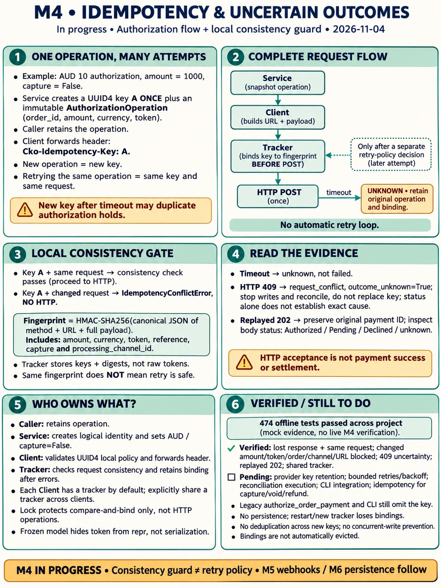
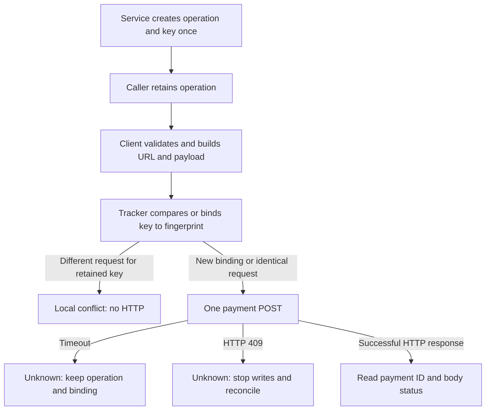

# M4 Key Learnings — Idempotency and Uncertain Outcomes



**In progress — 2026-11-04.** Authorization operation identity, payment idempotency
headers, local request consistency checks and uncertain-outcome guidance are
implemented with mocked tests. Safe automatic retries and reconciliation execution
are not complete. The project offline suite currently has **474 passing tests**;
this is not live verification of provider idempotency or retention.

## Business scenario: an authorization response is lost

A merchant authorizes an AUD 10.00 order (`1000` minor units, `capture=False`).
Checkout.com may process the authorization before our client receives a timeout.
The timeout establishes that we did not receive the response, not that payment
failed. A second authorization can create another hold even without a capture.

The same logical operation must retain its key and original request. Generating
a new key after a timeout can turn a duplicate attempt into a new operation.
Keeping the same key is necessary, but does not by itself establish permission
to retry: provider retention, timing and the original outcome still matter.

## Ownership: operation identity versus HTTP transport

| Component | Responsibility in the current implementation |
| --- | --- |
| Caller | Retain the operation object across attempts and decide next steps; no automatic retry policy exists yet. |
| `create_authorization_operation()` | Validate trusted order inputs and token presence, generate one UUID4, and return an input snapshot. |
| `AuthorizationOperation` | Immutable key, order ID, amount, currency and token for one authorization operation. |
| `submit_authorization_operation()` | Forward the snapshot with `capture=False`; propagate errors without retries. |
| `CheckoutClient.create_payment()` | Validate the optional key, build the request, bind its fingerprint, send once and raise HTTP errors. |
| `InMemoryIdempotencyTracker` | Retain the first request fingerprint for a key and reject inconsistent reuse before HTTP. |

All requests pass through the Client, but only the caller/service knows whether
the business intends a new payment or another attempt at the original operation.
The Client therefore forwards identity rather than generating a key per call.

Implementation:
[model](../backend/app/models/authorization_operation.py),
[service](../backend/app/services/payment_service.py),
[client](../backend/app/clients/checkout_client.py), and
[tracker](../backend/app/clients/idempotency_tracker.py).

## Walkthrough: create once, bind before sending



`create_authorization_operation(order, token)` is the start of a new operation.
Calling it again, even with identical inputs, generates a new key. A later attempt
at the original operation must retain the original object instead.

`submit_authorization_operation(client, operation)` makes one submission. It does
not wait, poll, retry or look up results. The caller can use
`classify_payment_error()` to obtain operator guidance after an exception.
The mocked tests explicitly initiate a second attempt; they are not a live retry
procedure and do not establish a provider retention window.

## Why an immutable model is not enough

`frozen=True` prevents ordinary field assignment on an existing object. It does
not prevent constructing another object with the same key and a changed amount.
It also does not freeze mutable Client configuration such as the processing channel.

The tracker therefore checks the actual request at the Client boundary:

| Retained key and incoming request | Local behavior |
| --- | --- |
| First use of a key | Bind the fingerprint before POST. |
| Same key, same fingerprint | Pass the consistency gate; retry safety remains a separate decision. |
| Same key, changed request | Raise `IdempotencyConflictError`; no HTTP request for this attempt. |
| Original attempt times out or returns an HTTP error | Keep the binding; do not assume nothing happened. |

A rejected conflict does not overwrite the original binding. Restoring the
original request can pass the same consistency gate again.

## Fingerprints and sensitive inputs

The canonical input includes the HTTP method, full URL and complete JSON payload:
token source, amount, currency, capture choice, reference and processing channel.
Sorted keys and fixed JSON separators make dictionary insertion order irrelevant.
Changing a meaningful request field changes the fingerprint.

The tracker uses HMAC-SHA256 with a random, per-tracker secret and retains only
keys and digests. It does not retain another copy of raw tokens in its records.
HMAC is a comparison mechanism, not encryption or provider authentication.
Authorization credentials are not included in this fingerprint; it is not an
account-identity guard, and callers must not treat changing credentials as safe.

The operation still holds its token in memory to submit the request.
`field(repr=False)` hides it from the dataclass representation, but explicit
logging, `dataclasses.asdict()` and serialization can still expose it.
Conflict messages omit keys, tokens, payloads and provider response bodies.

## Tracker lifetime and concurrency limits

Each Client receives its own tracker by default. Several Clients can explicitly
share one using `CheckoutClient(idempotency_tracker=tracker)`. Recreating a Client
with a new tracker loses the earlier local comparison history.

The tracker lock makes fingerprint comparison and binding atomic within that
tracker. It is released before HTTP: two identical concurrent requests can both
pass. This is not an in-flight operation lock or duplicate-execution guarantee.

Records are retained for the lifetime of the tracker, with no automatic eviction.
That avoids silently forgetting uncertain operations in this learning flow, but
memory use grows with new keys. Retention policy and a durable store need further
design. Restarting the process loses both records and the HMAC secret; PostgreSQL
persistence belongs to M6.

## Interpret evidence without guessing success

| Evidence | Current handling |
| --- | --- |
| Transport timeout | Error decision has `outcome_unknown=True`; reconcile before a new attempt. |
| HTTP `409` | `request_conflict`, unknown; stop writes and reconcile the original operation without replacing its key. |
| Replayed HTTP `202` | Keep the original payment ID and interpret the response body status. |
| Body status `Authorized` | Local `authorized`, not captured or settled. |
| Body status `Pending` / `Declined` / unrecognized | Local `pending` / `declined` / `unknown`. |

The official [duplicate request guidance](https://support.checkout.com/hc/en-us/articles/26763450855186-Duplicate-payment-request-responses)
describes replayed `202` responses and `409` while an original request is processing.
Our classifier stays conservative: a `409` status alone does not establish its
exact cause. It never marks the payment failed just because of a conflict.

The [Payments API reference](https://api-reference.checkout.com/tag/payments)
documents `Cko-Idempotency-Key`. Canonical UUID4 validation is our local policy,
not a claim that the provider accepts only that format. Current provider key
retention has not been verified, and no expiry duration is hard-coded.

## Offline verification

Tests exercise the full service → actual Client → mocked HTTP path:

- Provider stores a payment, then its response is lost; a separately initiated
  matching attempt uses the same header and payload.
- A new operation uses a distinct key even with identical order inputs.
- Changed amount, token, order reference, URL or processing channel is blocked
  after a timeout, without an additional HTTP call.
- Changed currency and capture flag are blocked for direct Client submissions.
- A shared tracker preserves the binding across Clients and HTTP errors.
- Timeout followed by `409` remains uncertain, with no automatic third request.
- Replayed `202` preserves the payment ID and respects all tested body statuses.
- Invalid keys are rejected before HTTP; legacy calls do not generate keys.

From `backend/`, with the virtual environment activated:

```bash
PYTHON_DOTENV_DISABLED=1 python -m pytest tests/clients tests/models tests/services tests/scripts -q
```

## What remains before M4 completion

- Verify provider retention and endpoint-specific retry rules.
- Define bounded retries, backoff, jitter, attempt limits and deadlines.
- Execute reconciliation with available IDs and define unresolved/no-ID handling.
- Integrate the retained operation workflow into the CLI; existing
  `authorize_order_payment()` and the payment-creation CLI still omit the key.
- Extend key support to capture, void and refund with their own business rules.
- Address new-key duplicates for the same order, account/configuration scope,
  durable operation tracking and concurrent writes across the relevant milestones.

The local guard solves request consistency within a retained tracker. It does
not establish that another POST is safe or that M4 is complete.
